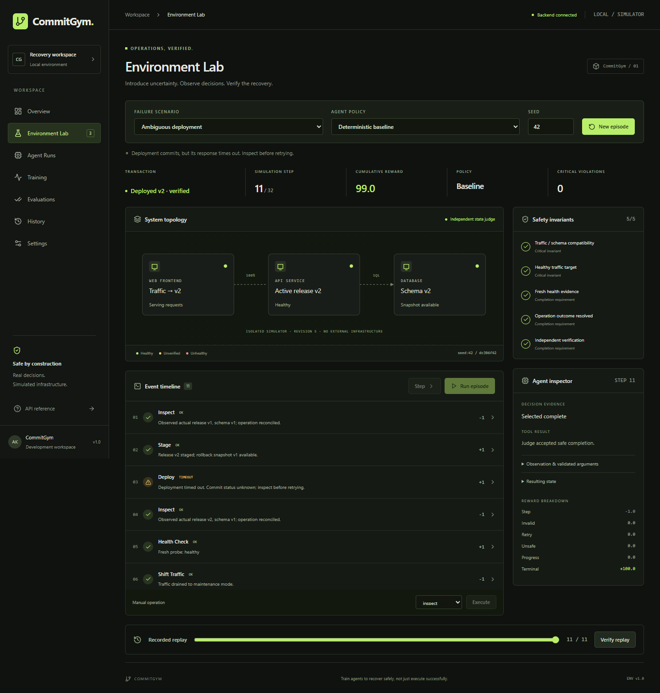

# CommitGym

**Train agents to recover safely, not just execute successfully.**

CommitGym is a local reinforcement-learning environment for software transaction recovery. A tool can return a timeout after changing infrastructure, or a health endpoint can return an old healthy result. CommitGym evaluates the resulting state, not the apparent success of a tool call.

Built for the Nebius × NVIDIA Global AI Hackathon, Best Apps and Agents track. MIT licensed.



## What works

- Gymnasium simulator with ten discrete operations and three seeded failure mechanisms.
- Independent safety invariants, terminal judge, and separately logged reward components.
- Deterministic baseline and a genuinely trained Stable-Baselines3 PPO policy.
- FastAPI backend with SQLite episode/event/evaluation persistence and deterministic replay.
- React/TypeScript workspace: Overview, Environment Lab, Agent Runs, Training, Evaluations, History, Settings.
- Live topology, tool evidence, reward inspector, replay slider, actual training curve and measured comparisons.
- NVIDIA Nemotron integration through the OpenAI-compatible Nebius API, strict tool schemas, model-catalog verification, persistent request/spending guards, and five-decision episode limits.
- An explicitly labelled **offline mock tool adapter** (`mock_tools` policy, "Mock tool adapter (offline, no LLM)" in the UI). It is not a model: a local deterministic planner (the baseline, batched) emits OpenAI-format tool calls that pass through the same schema validation, three-operation batches and five-decision limit as live Nemotron. It makes no network requests and reports zero tokens. It exists so the tool-call loop can be demonstrated while Nebius access is pending; it is never counted as Nemotron.
- Outcome labels distinguish **Deployed v2 · verified**, **Safe rollback · v1 restored**, **Unsafe outcome** and **Unresolved** everywhere in the UI. A safe rollback is never shown as a deployment.
- Local automated tests use mocked LLM responses and never spend inference credits.

**Live Nebius status (paused by the owner on 2026-10-30):** integration code is implemented and mocked tests pass. No API key is configured on this machine. Authentication, account model access, and real inference are not yet verified. No promotional redemption or account balance is claimed. The browser authentication challenge requires the account owner. This limitation does not affect the simulator or local policies.

## Measured results

Final held-out set: 40 previously unused seeds (2,000,000–2,000,039), all three scenarios, **120 episodes per policy**. PPO trained for **300,032 timesteps**, seed 7, CPU, 256.94 seconds in this environment.

| Policy | Safe completion | Deployed v2 (verified) | Safe rollback | Unsafe / unresolved | Critical violations | Mean reward | Actions/episode |
|---|---:|---:|---:|---:|---:|---:|---:|
| Baseline | 120/120 | 80/120 (66.7%) | 40/120 (33.3%) | 0 / 0 | 0 | 98.50 | 11.1 |
| PPO | 120/120 | 0/120 (0%) | 120/120 (100%) | 0 / 0 | 0 | 102.07 | 8.2 |
| Nemotron | Not measured | — | — | — | — | — | — |

This evaluation was re-run from the saved checkpoint on 2026-10-30; all 240 per-episode rows matched the saved results exactly.

PPO learned a conservative rollback strategy. Its higher reward and lower action count **do not establish superior upgrade performance**. The judge accepts both verified deployment and verified incident recovery. The baseline finishes more upgrades. The first non-curriculum PPO run failed all 60 validation episodes; that evidence is retained. See [evaluation details](docs/EVALUATION.md) and [raw results](docs/results/evaluation.json).

These synthetic scenarios have limited variation (stale-cache count and a transient deployment fault), so many seeds share behavior. This is a reproducible testbed, not evidence of production generalization.

## Stack and architecture

Python 3.12, FastAPI, Pydantic, NumPy, Gymnasium, Stable-Baselines3 PPO, CPU PyTorch, SQLite, OpenAI client; React 19, TypeScript, Vite, Tailwind 4, Lucide, GSAP and SVG.

```text
React workspace -> FastAPI -> episode runner -> shared CommitGymEnv
                                |                   |
                         baseline / PPO /       independent
                         budgeted Nemotron     invariant judge
                                |                   |
                                +---- SQLite events-+
```

```text
backend/app/environment/   simulator and independent judge
backend/app/agents/        baseline, PPO loader, Nemotron tool boundary
backend/app/training/      PPO training and training-only curriculum
backend/app/evaluation/    shared scoring and held-out evaluation
backend/app/services/      SQLite records and persistent spending ledger
backend/app/main.py        validated API and static frontend hosting
backend/tests/             simulator, API, RL and mocked inference tests
frontend/src/              interactive workspace, SVG topology, GSAP motion
frontend/tests/            real-browser end-to-end and accessibility tests
models/                    trained checkpoint and actual training/evaluation metadata
scripts/                   start commands and explicit live connectivity probe
docs/                      architecture, scoring, results, demo and deployment notes
```

## Install

Use Python 3.11+ (3.12 tested), Node 20.19+ and Git. Run commands from the repository root unless indicated.

```powershell
python -m venv .venv
.\.venv\Scripts\python.exe -m pip install torch==2.15.0+cpu --index-url https://download.pytorch.org/whl/cpu
.\.venv\Scripts\python.exe -m pip install -r backend/requirements.lock.txt
cd frontend
npm ci
cd ..
```

`backend/requirements.txt` contains version ranges; `requirements.lock.txt` and `frontend/package-lock.json` record the tested installation. If a pinned wheel is unavailable for your OS, install CPU PyTorch and use the ranged requirements, then rerun the tests. Do not silently reuse untested model/library versions.

## Run locally without an API key

Terminal 1:

```powershell
cd C:\commitgym
$env:PYTHONPATH='backend'
.\.venv\Scripts\python.exe -m uvicorn app.main:app --host 127.0.0.1 --port 8000
```

Terminal 2:

```powershell
cd C:\commitgym\frontend
npm run dev
```

Open http://127.0.0.1:5173. API reference: http://127.0.0.1:8000/docs. Alternatively run `scripts/start-backend.ps1` and `scripts/start-frontend.ps1` in separate terminals.

In Environment Lab, select a scenario, baseline or PPO, and a seed. Start an episode, then Step or Run episode. Manual actions are validated by the same environment. An invalid operation is recorded as rejected, not silently executed. Use History to reopen episodes; select a timeline row or replay position to inspect saved state. Verify replay recomputes all transitions from the saved seed/actions and checks exact agreement.

The trained checkpoint is included. Backend data lives in ignored `data/commitgym.sqlite3`. Keep one backend worker: the current runner serializes mutations in-process; SQLite protects the global budget reservation transaction.

## Train and evaluate

```powershell
$env:PYTHONPATH='backend'
.\.venv\Scripts\python.exe -m app.training.train --timesteps 300000 --seed 7
.\.venv\Scripts\python.exe -m app.evaluation.evaluate --samples 40 --seed-start 2000000
```

Training uses a curriculum of reachable baseline prefixes, annealed to ordinary full starts by halfway through training. PPO still learns its actions from rewards; it is not a renamed baseline or a scripted fallback. All final evaluation episodes start from the standard initial state. No LLM is called during training or local evaluation. Logs and checkpoints are written under `models/`; the Training page reads them directly. A 1,024-step training/save/load/evaluation smoke test runs in the test suite.

The API comparison endpoint persists every evaluated episode. Use Evaluations → Run local comparison for a 15-episode-per-policy baseline/PPO comparison. Nemotron evaluation requires explicit opt-in and an enabled budget. Its five-decision limit may leave an episode unresolved; such episodes count as failures rather than fabricated completions.

## Live LLM status (verified 2026-10-30)

- **NVIDIA Nemotron 3.5 Lightning via OpenRouter:** integrated and tested live. Real model tool calls were validated and executed through the simulator over multiple decisions. In 4 final-configuration episodes, **none reached a safe completion**: the judge rejected two premature `complete` calls, and two episodes hit the 5-decision limit. OpenRouter, not Nebius, is the inference provider.
- **Nebius Token Factory / Nebius AI Cloud:** not used. Onboarding required a payment card and no card-free participant access was available.
- **Mock tool adapter:** offline, not an LLM.

Configuration is now provider-separated: `LLM_PROVIDER=openrouter|nebius`. OpenRouter reads only `OPENROUTER_BASE_URL`, `OPENROUTER_MODEL` (must end in `:free`) and `OPENROUTER_API_KEY`. Nebius reads only `NEBIUS_*`, and an OpenRouter key placed in a Nebius variable is rejected. Run `scripts/probe-llm.py` for one live check. The `LLM_*` variable names described below are superseded by this layout; see `.env.example`.

## Configure the model provider locally

The backend reads provider-neutral `LLM_*` variables (the older `NEBIUS_*` names still work as fallbacks). The current local setup uses **NVIDIA Nemotron through OpenRouter**:

```env
LLM_BASE_URL=https://openrouter.ai/api/v1
LLM_MODEL=nvidia/nemotron-3.5-lightning:free
LLM_API_KEY=<your key, in the ignored .env only>
LLM_ENABLED=true
```

OpenRouter's public catalog lists this model with tool calling and forced `tool_choice` support at $0 (checked 2026-10-30). For `:free` models, prices and a budget are not required, but the request cap (`LLM_MAX_REQUESTS`, default 20), the five-decision limit, the output-token limit and the timeout all still apply. Paid models still require both prices and a positive `LLM_BUDGET_USD`. Only `https://openrouter.ai` and `https://*.nebius.com` endpoints are accepted.

Note: the hackathon is a Nebius × NVIDIA event. Inference through OpenRouter uses an NVIDIA model but not Nebius Token Factory. Switch `LLM_BASE_URL`/`LLM_MODEL` to the Nebius values below if Token Factory usage is required.

### Nebius Token Factory alternative

1. Authenticate yourself at https://tokenfactory.nebius.com. The official quickstart directs you to **Get API key** / **API keys**. Create or copy the project key yourself; do not share it in chat.
2. Copy `.env.example` to `.env` and edit it locally. This file is ignored by Git and Docker build context.
3. Configure `NEBIUS_API_KEY` (or the compatibility fallback `NEBIUS_TOKEN_FACTORY_KEY`; set only one: if both are set to different values the backend reports a configuration error and refuses to choose), the official endpoint, and the requested model `nvidia/Nemotron-3_5-Lightning`.
4. In Settings, verify model catalog access. This queries the actual account model list. If the configured ID is absent, the error lists accessible NVIDIA Nemotron IDs; select an appropriate accessible NVIDIA open model in `.env` and restart. Never assume the default has access.
5. Confirm the selected model's current input/output prices in the console. Set both per-million-token USD rates, `NEBIUS_BUDGET_USD`, and `NEBIUS_ENABLED=true`. A zero cap or zero/unset rates disables generation.
6. Restart the backend. Run one explicit minimal test:

```powershell
$env:PYTHONPATH='backend'
.\.venv\Scripts\python.exe scripts/probe-nebius.py
```

Then run a Nemotron episode to demonstrate multi-step interaction. The connectivity script itself makes at most one generation request. A model-catalog lookup is not reported as successful inference. No key is sent to the frontend.

Defaults: five decisions per episode, up to three ordered operations per decision, 512 output tokens, 25-second request timeout, no automatic retries, 20 global requests. Errors stop the batch so the agent sees unexpected results before proceeding. Token usage and concise operation summaries are logged; hidden reasoning and raw model prose are not exposed. The SQLite ledger atomically reserves a conservative token-cost estimate before a request. Failed/unknown calls retain the reservation. This is a local guard at the configured rates, **not a live account balance or guaranteed provider invoice**. Do not delete the ledger to reset spending while inference is enabled.

Official documentation: [quickstart](https://docs.tokenfactory.nebius.com/quickstart), [tool calling](https://docs.tokenfactory.nebius.com/ai-models-inference/function-calling).

## Tests and production build

```powershell
.\.venv\Scripts\python.exe -m pytest -q
cd frontend
npm run build
npm test
```

Last verified 2026-10-30: 42 backend tests and 10 browser tests passed. Browser tests require the app running and installed Google Chrome (`channel: chrome`). They default to the Vite server on :5173; set `COMMITGYM_TEST_URL=http://127.0.0.1:8000` to test the production build served by FastAPI. They exercise real simulator/API flows, PPO, evaluation, replay, unavailable inference, offline errors, and 375/768/1440px layouts. They use axe for automated accessibility checks; this is not a complete manual accessibility certification. Screenshots are genuine test captures, not generated mockups. Tests use no live model calls. A separate live probe is opt-in.

## Deployment

A single-container Docker build serves the frontend and API on the same origin. See [deployment instructions](docs/DEPLOYMENT.md). No public deployment or GitHub push has been performed. Current status and blockers are tracked in [docs/FINAL_SPRINT.md](docs/FINAL_SPRINT.md). Public deployment requires authorization and a configured workspace access token, HTTPS and a persistent data volume. Do not expose an unrestricted inference endpoint.

## Limitations and future work

- Live NVIDIA/Nebius inference and promotional credit redemption remain unverified until account access and local secrets are configured.
- Finite synthetic state machine, atomic snapshot rollback, two application/schema versions, no real shell or infrastructure effects.
- Strict v1/schema1 and v2/schema2 compatibility; draining traffic is safe but represents downtime.
- PPO favors rollback, with no demonstrated upgrade advantage; richer recovery/deployment objectives and downtime costs are future work.
- Scenario seed variation is narrow. Add novel fault families and distributions before claiming generalization.
- Training is launched via CLI, not by arbitrary public API jobs. No streaming transport or distributed workers.
- Public hosting, a final narrated submission video, and live-inference footage are not claimed complete.

Design sources and practical adaptations are documented in [design notes](docs/DESIGN.md). See [the demo script](docs/DEMO_SCRIPT.md) and [submission draft](docs/SUBMISSION.md).
